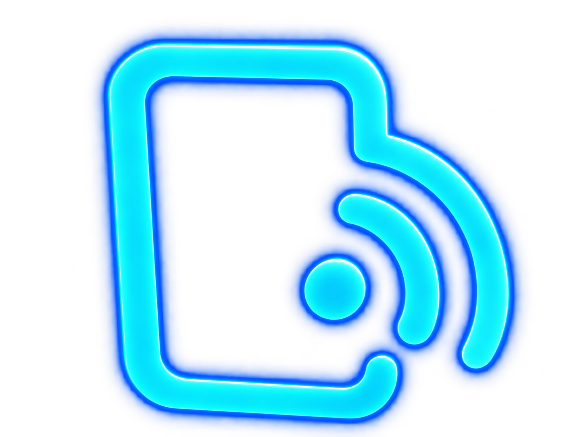

  

  # PhoneCast

  **Android screen sharing and remote interaction for your Windows PC — over your local network.**

  
  
  
  
  

---

## Overview

PhoneCast is a two-part application that lets an Android phone share its screen with a desktop app and supports remote interaction during an authorized session.

It consists of:

- **PhoneCast Android** — advertises the phone on the local network, asks for approval, obtains Android screen-capture consent, captures the display, and encodes video.
- **PhoneCast Desktop** — discovers the phone, initiates a connection, receives and decodes the video stream, displays the phone screen, and sends supported control input.

PhoneCast is designed for direct communication over a local network. The current architecture does not require a PhoneCast cloud account, cloud relay, or third-party streaming server.

> **Project status:** PhoneCast is under active development. The screen-sharing path is the core workflow; remote-input coverage and some UI/workspace features are still evolving. This repository does not currently provide a verified production installer or promise compatibility with every Android device or network.

## Contents

- [Features](#features)
- [Current status and scope](#current-status-and-scope)
- [Architecture](#architecture)
- [Requirements](#requirements)
- [Run the desktop app on Windows](#run-the-desktop-app-on-windows)
- [Run the Android app](#run-the-android-app)
- [Build an Android APK](#build-an-android-apk)
- [Connect a phone and PC](#connect-a-phone-and-pc)
- [Network requirements](#network-requirements)
- [Security and privacy](#security-and-privacy)
- [Troubleshooting](#troubleshooting)
- [Repository layout](#repository-layout)
- [Technology stack](#technology-stack)
- [Development and contribution workflow](#development-and-contribution-workflow)
- [Known limitations and roadmap](#known-limitations-and-roadmap)
- [License](#license)
- [Maintainer](#maintainer)

---

## Features

### Android

- Onboarding and local profile setup.
- Local device security/authentication flow.
- LAN service advertisement using Android Network Service Discovery (NSD).
- Incoming connection request with explicit accept/reject.
- Android \`MediaProjection\` consent before screen capture.
- Foreground screen-capture service.
- H.264 video encoding through Android \`MediaCodec\`.
- Video stream served to the desktop over TCP.
- Local connection-history functionality.

### Desktop

- Electron desktop application.
- Phone discovery over mDNS/Bonjour.
- Device selection and laptop-initiated connection requests.
- Separate control and video connections.
- H.264 decoding through Chromium WebCodecs.
- Canvas-based live phone viewer.
- Session status and disconnect handling.
- Remote-input UI and control pathways that are still being developed and should be tested on the target device.

### Not currently promised as complete

The following are not complete, production-ready features of the current \`main\` branch:

- Full, device-independent touch, pointer, gesture, and keyboard coverage.
- Calls, reliable call history, or full contact management.
- Reading/sending messages across all Android apps.
- Clipboard synchronization, general file transfer, drag-and-drop, or recording.
- A production-signed Windows installer and automatic updates.
- Phoney AI or other assistant features.

A screen or button in the UI should not be interpreted as proof that its end-to-end backend workflow is finished.

## Current status and scope

| Area | Status |
|---|---|
| Android onboarding and local profile flow | Implemented; verify on the target device |
| LAN discovery | Implemented; depends on network and firewall configuration |
| Connection request and phone-side approval | Implemented in the core flow |
| Android authentication and screen-capture consent | Uses Android system permission/authentication flows |
| H.264 screen capture and desktop rendering | Core implementation present; device testing is required |
| Remote touch/pointer/keyboard | In development; coverage may vary |
| Calls, cross-app messages, file transfer, clipboard, recording, AI | Planned or incomplete |
| Production desktop packaging | Not documented as a verified release process |

This table describes the implementation direction, not a guarantee that every feature works on every device. Re-test the full flow after changes to networking, permissions, video, or input handling.

## Architecture

\`\`\`mermaid
flowchart LR
    subgraph Android["PhoneCast Android"]
        NSD["NSD service advertisement"]
        REQUEST["Connection request UI"]
        CONSENT["Authentication and MediaProjection consent"]
        CAPTURE["ScreenCaptureService"]
        ENCODE["H.264 / MediaCodec"]
        CONTROL_A["TCP control server"]
        VIDEO_A["TCP video server"]
        INPUT["Supported remote input"]
    end

    subgraph Desktop["PhoneCast Desktop (Electron)"]
        DISCOVERY["Bonjour / mDNS discovery"]
        CONTROL_D["TCP control client"]
        VIDEO_D["Video client"]
        DECODE["WebCodecs VideoDecoder"]
        VIEWER["Canvas viewer"]
        INPUT_D["Input capture"]
    end

    NSD -. "_phonecast._tcp" .-> DISCOVERY
    DISCOVERY --> CONTROL_D
    CONTROL_D <-->|"Newline-delimited JSON"| CONTROL_A
    CONSENT --> CAPTURE --> ENCODE --> VIDEO_A
    VIDEO_A -->|"H.264 over TCP"| VIDEO_D --> DECODE --> VIEWER
    INPUT_D --> CONTROL_D
    CONTROL_A --> REQUEST
    CONTROL_A --> INPUT
\`\`\`

### Connection lifecycle

1. Start PhoneCast on the phone and desktop.
2. Put both devices on a network that permits local device-to-device traffic.
3. The Android app advertises the \`_phonecast._tcp\` service.
4. The desktop discovers the phone and the user selects it.
5. The desktop initiates the control connection and sends a connection request.
6. The phone user accepts or rejects the request.
7. Android authentication and screen-capture consent are completed when requested.
8. Android captures the display, encodes H.264, and announces that the video stream is ready.
9. The desktop receives and decodes the video, then renders it in the viewer.
10. The user ends the session from the desktop or phone as supported by the current flow.

**Discovery is not authorization.** Finding a phone on the network does not itself start screen sharing. The laptop initiates the connection, but the phone user must approve the session and Android must grant screen-capture consent.

### Transport overview

| Channel | Direction | Data |
|---|---|---|
| Discovery | Android advertises; desktop browses | mDNS/NSD service information |
| Control | Bidirectional | Newline-delimited JSON commands and status events |
| Video | Android to desktop | H.264 stream over TCP |

The control and video channels are separate so that continuous video traffic does not share the same application-level message stream as session commands. Protocol details may change while development continues; update both clients together when changing message types or packet framing.

## Requirements

### Desktop development (Windows-first)

- Windows 10 or Windows 11 PC.
- Git.
- **Node.js 22 LTS** recommended, with npm.
- A network connection that allows the phone and PC to reach each other.
- Current PhoneCast source from this repository.

The desktop app is built with Electron. The repository currently defines a \`start\` script; it does **not** define a production packaging script in \`desktop/package.json\`.

### Android development

- Android Studio with a compatible Android SDK installation.
- **Android SDK Platform 36**, matching the current \`compileSdk\`.
- JDK 17 or a compatible newer JDK supported by the Gradle/Android Gradle Plugin versions in the repository. Android Studio's configured Gradle JDK can be used.
- An Android phone running **Android 8.0 (API 26) or later** for device testing.
- USB debugging enabled if installing/running over USB, or a way to install the generated APK.
- Wi-Fi or another local network that permits direct traffic between the phone and PC.

The repository includes the Gradle wrapper, so a separate global Gradle installation is not required.

## Run the desktop app on Windows

### 1. Clone the repository

Open PowerShell or a terminal:

\`\`\`powershell
git clone https://github.com/Yash-0608/PhoneCast.git
cd PhoneCast
\`\`\`

### 2. Install desktop dependencies

\`\`\`powershell
cd desktop
npm ci
\`\`\`

Use \`npm ci\` for a clean install based on the committed lockfile. You normally need to repeat it only when dependencies change or your install is missing/corrupt.

### 3. Start PhoneCast

\`\`\`powershell
npm start
\`\`\`

This runs the Electron entry point configured in \`desktop/package.json\`. Keep the terminal open while testing so you can see startup and networking logs.

To restart the desktop app, close it and run \`npm start\` again from the \`desktop\` directory.

## Run the Android app

### Option A — Android Studio

1. Clone the repository if you have not already.
2. Open **the repository root** (\`PhoneCast/\`) in Android Studio, not just the \`app/\` subfolder. The root contains \`settings.gradle.kts\` and the Gradle wrapper.
3. Allow Gradle sync and SDK installation to finish.
4. Connect an Android phone with USB debugging enabled, or select a compatible emulator for UI-only development.
5. Select the \`app\` run configuration and click **Run**.
6. On the phone, complete onboarding and grant Android permissions when prompted.

A physical phone is recommended for end-to-end LAN discovery and screen-sharing tests. Emulator networking may prevent normal local discovery.

### Option B — Build from PowerShell

From the repository root:

\`\`\`powershell
.\gradlew.bat :app:assembleDebug
\`\`\`

On macOS/Linux, use:

\`\`\`bash
./gradlew :app:assembleDebug
\`\`\`

The first build may take longer while Gradle downloads the required Gradle distribution, plugins, and Android dependencies.

## Build an Android APK

Build the debug APK from the repository root:

\`\`\`powershell
.\gradlew.bat :app:assembleDebug
\`\`\`

Expected output:

\`\`\`text
app/build/outputs/apk/debug/app-debug.apk
\`\`\`

Install it on a connected Android device with ADB:

\`\`\`powershell
adb devices
adb install -r app\build\outputs\apk\debug\app-debug.apk
\`\`\`

If the device is not listed by \`adb devices\`, check the USB cable, enable Developer options and USB debugging, and accept the authorization prompt on the phone.

This is a **debug build**, not a production release. A distributable release requires a deliberate signing and release process. Do not commit signing keys, passwords, or keystore files.

## Connect a phone and PC

1. Install and open PhoneCast on Android.
2. Start the desktop app with \`npm start\`.
3. Connect the phone and PC to the same trusted Wi-Fi/LAN.
4. Keep the phone unlocked and the app ready for incoming requests.
5. Refresh or wait for device discovery in the desktop app.
6. Select the discovered phone and initiate a connection.
7. Accept the request on the phone.
8. Complete Android authentication and grant screen-capture permission if prompted.
9. Wait for the live video to appear in the desktop viewer.
10. Test remote input separately; its support may depend on the current implementation, Android version, and required Android service/permissions.
11. Disconnect the session before closing either app.

## Network requirements

PhoneCast relies on direct local-network communication.

- The phone and PC should normally be on the same LAN.
- Guest Wi-Fi, client/AP isolation, VPN routing, or corporate network rules may block discovery or direct connections.
- Windows Firewall may block Electron or incoming local TCP traffic. When prompted, allow PhoneCast on a trusted **Private** network only if you understand and approve the access.
- Avoid public or untrusted networks for testing.
- Do not assume discovery working means the control and video connections are reachable; those are separate stages.

PhoneCast does not promise that every router, hotspot, VPN, or firewall configuration will work without adjustment.

## Security and privacy

- The connection is initiated by the desktop, but the phone user must approve the request.
- Android's authentication and \`MediaProjection\` consent are handled through Android's system flows; PhoneCast should not bypass them.
- Screen capture and remote input should only be used in sessions the phone user has authorized.
- The architecture is LAN-first and does not require a PhoneCast cloud relay for the core flow.
- The current control/video design uses TCP sockets. **Do not assume transport encryption is present.** Use a trusted network and avoid sensitive activity until transport security has been explicitly implemented and verified.
- Keep Android permissions limited to what the current feature requires. Do not commit credentials, signing keys, local machine configuration, or generated secrets.

## Troubleshooting

| Problem | Checks |
|---|---|
| Desktop app does not start | Run \`npm ci\` in \`desktop/\`; verify Node.js/npm; read the terminal error; confirm you ran \`npm start\` from \`desktop/\`. |
| Gradle sync/build fails | Open the repository root in Android Studio; verify SDK Platform 36 and JDK/Gradle compatibility; retry after SDK installation completes. |
| Phone is not discovered | Confirm both devices are on the same LAN; keep PhoneCast open on Android; check VPN, guest Wi-Fi/client isolation, and Windows Firewall. |
| Phone appears but connection fails | Check the desktop terminal and Android logs; confirm the phone is ready to accept requests; verify local traffic is not blocked. |
| Request is accepted but no video appears | Grant Android screen-capture consent; inspect capture/encoder logs; verify the video connection can reach the desktop. |
| Video starts but looks broken or freezes | Check device encoder support, network stability, and Electron/Chromium decoding logs. Test on another trusted network if possible. |
| Remote input does not work | Test the video path first; confirm the session is authorized; check any PhoneCast accessibility/input service and Android permission requested by the app; note that full input coverage is still in development. |
| ADB cannot see the phone | Reconnect USB, enable USB debugging, accept the phone's authorization dialog, and run \`adb devices\` again. |

### Debugging by layer

When diagnosing an issue, isolate the stages in order:

1. Discovery — does the desktop see the phone?
2. Control TCP — can the desktop open the control connection?
3. Request — did the phone receive the connection request?
4. Authorization — did the phone user accept?
5. Android authentication — did the system authentication step complete?
6. Capture — was \`MediaProjection\` granted and capture started?
7. Encoding/video transport — did the H.264 stream become available?
8. Decode/render — did the desktop decode and display frames?
9. Input — are remote input events being sent and applied?

## Repository layout

\`\`\`text
PhoneCast/
├── app/
│   └── src/main/
│       ├── AndroidManifest.xml
│       ├── java/com/phonecast/app/
│       │   ├── MainActivity.kt
│       │   ├── capture/
│       │   │   └── ScreenCaptureService.kt
│       │   ├── network/
│       │   │   └── PhoneCastDiscovery.kt
│       │   └── ui/theme/
│       └── res/
├── desktop/
│   ├── electron/
│   │   ├── main.js
│   │   └── preload.js
│   ├── renderer/
│   │   ├── index.html
│   │   ├── renderer.js
│   │   ├── style.css
│   │   ├── core/
│   │   ├── connection/
│   │   ├── pages/
│   │   ├── state/
│   │   ├── ui/
│   │   └── video/
│   ├── package.json
│   └── package-lock.json
├── gradle/
│   └── wrapper/
├── gradlew
├── gradlew.bat
├── build.gradle.kts
├── settings.gradle.kts
├── gradle.properties
└── Readme.md
\`\`\`

The tree highlights the main entry points; individual files may be added as development progresses.

## Technology stack

| Component | Technology | Role |
|---|---|---|
| Android app | Kotlin, Android SDK, Jetpack Compose | Mobile UI and lifecycle |
| Device discovery | Android NSD / mDNS | Advertise and find devices on the LAN |
| Screen capture | \`MediaProjection\` | Obtain user-approved display capture |
| Video encoding | \`MediaCodec\` | Encode the screen as H.264 |
| Desktop shell | Electron | Windows desktop application |
| Desktop runtime | Node.js | Networking and native desktop process |
| Discovery client | \`bonjour-service\` | Discover the Android service |
| Control/video networking | Node TCP sockets and Android networking APIs | Exchange control messages and video |
| Video decoding | WebCodecs | Decode H.264 frames in the desktop renderer |
| UI | HTML, CSS, JavaScript | Desktop screens and live viewer |
| Build | Gradle wrapper, Android Gradle Plugin | Android build and APK generation |

## Development and contribution workflow

1. Create a focused feature or fix branch from the branch you intend to target.
2. Inspect the current implementation before changing a protocol, permission, or cross-app workflow.
3. Keep Android and desktop protocol changes compatible.
4. Run the desktop app and/or Android build for the files you changed.
5. Test the full phone-to-PC path for networking, capture, video, and input changes.
6. Update this README when setup steps, protocol behavior, requirements, or supported features change.
7. Open a pull request with the change summary, test steps, observed results, and known limitations.

Useful commands:

\`\`\`powershell
# Desktop: from repository root
cd desktop
npm ci
npm start

# Android: from repository root (run separately)
.\gradlew.bat :app:assembleDebug
\`\`\`

Do not commit generated build output, dependency folders, local SDK configuration, or secrets. The repository's \`.gitignore\` covers common Android/Gradle generated files and local configuration.

## Known limitations and roadmap

### Current limitations

- Local discovery and direct connection depend on the network and firewall.
- Android permission and foreground-service requirements vary by OS version and device.
- Encoding and decoding performance depend on device hardware and the Electron/Chromium runtime.
- Remote input behavior and gesture/keyboard coverage are not guaranteed across all Android devices.
- The current repository does not document a tested production Windows installer or update mechanism.
- TCP traffic should be treated as unencrypted unless transport encryption is explicitly added and verified.

### Potential next steps

- Improve remote touch, pointer, scroll, and keyboard reliability.
- Improve reconnection, session cleanup, and diagnostics.
- Add protocol-level tests and more automated integration coverage.
- Add secure transport and document the threat model.
- Add a verified desktop packaging/signing workflow.
- Explore clipboard/file transfer and other workspace features only after their permissions, privacy model, and end-to-end behavior are implemented.

These items are roadmap ideas, not claims about current functionality.

## License

There is currently no root-level \`LICENSE\` file on the \`main\` branch. The desktop package metadata names MIT, but that alone does not replace a repository license. Until a license is added by the maintainer, do not assume that redistribution or reuse is permitted.

## Maintainer

**Yash Takalkar**

- GitHub: [@Yash-0608](https://github.com/Yash-0608)
- LinkedIn: [yash-takalkar](https://linkedin.com/in/yash-takalkar-5a364a284)
- Portfolio: [portfolio-website-one-xi-92.vercel.app](https://portfolio-website-one-xi-92.vercel.app)
